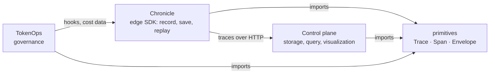

<div align="center">

# Chronicle

**Record what your agent did. Replay a request without the LLM.**<br>
<sub>The edge SDK of the AgentPlane suite: record at each decision point, save to the control plane, replay a recorded request to test a fix.</sub>

[](https://github.com/theagentplane/chronicle/actions/workflows/ci.yml)
[](https://pypi.org/project/agent-chronicle/)
[](https://arxiv.org/abs/2609.20625)
[](https://pypi.org/project/agent-chronicle/)
[](https://github.com/theagentplane/chronicle/blob/main/LICENSE.txt)
[](https://peps.python.org/pep-0561/)
[](https://github.com/astral-sh/ruff)

<sub>To appear at <a href="https://realm-workshop.github.io/">REALM</a> (Research on Agent Language Models), a workshop at EMNLP 2026</sub>

<br>

[What it is](#what-it-is) · [Quickstart](#quickstart) · [How it fits](#how-it-fits) · [Scope](#scope) · [Configuration](#configuration) · [Versioning](#versioning) · [Development](#development) · [Roadmap](#roadmap) · [Support](#support)

</div>

> **1.0 is a clean break from 0.5.** Chronicle now records onto the shared
> [`agentplane-primitives`](https://github.com/theagentplane/primitives) schema and saves to the
> control plane over HTTP. Local stores, fixtures, the CLI and the visualizer are gone. Read the
> [migration note](docs/migration-0.5-to-1.0.md) before upgrading.

## What it is

Chronicle runs inside your agent's own process and does three things:

1. **Record** what the agent did at each decision point (a *boundary*: an LLM call or a tool call).
2. **Save** it to the control plane, the shared HTTP service that stores, queries and visualizes traces.
3. **Replay** one recorded request so a fix can be tested without live LLM calls.

It stores nothing locally, draws nothing and does not export to OpenTelemetry. Those belong to the
control plane. That is what makes Chronicle small enough to live in every agent.

| | |
|---|---|
| **One lifecycle** | `@boundary`, `wrap(client)`, `wrap_llm` and the instrumenters all go through one interceptor. |
| **Only two kinds** | A boundary is an `llm` call or a `tool` call. A router is one or the other. |
| **Cost fields that never move** | `output.provider`, `output.model` and exclusive, additive `output.usage` buckets are filled the same way for every SDK and agent framework. |
| **Raw is always stored** | The input and output exactly as they crossed the boundary, so replay needs no reverse mapping. |
| **Transparent** | The caller always gets the real return value or the real exception. Only a hook's `AbortCall` can stop a call. |
| **Cross-service traces** | The W3C `traceparent` header carries the trace; A2A, plain HTTP and any `httpx` based protocol are covered. |
| **Safe by default** | `traceparent` goes only to hosts you list; redaction runs before anything is sent. |

## Quickstart

```bash
pip install agent-chronicle
```

Point Chronicle at a control plane (environment variables work too, see [Configuration](#configuration)):

```python
import chronicle

chronicle.configure(
    control_plane_url="http://control-plane:8000",
    api_key="...",
    service_name="support-agent",
    inject_hosts=["billing-agent.internal"],  # peers that receive the trace header
)
```

**1. Wrap your model client.** Every model call is recorded; streaming (`stream=True`) is not supported
and passes straight through.

```python
from openai import OpenAI

client = chronicle.wrap(OpenAI())
client.chat.completions.create(model="gpt-4o", messages=[...])  # recorded
```

`wrap` detects OpenAI, Azure OpenAI, Anthropic and LiteLLM from the client type. An unknown client
records `provider = "unknown"` and `usage = null`.

**2. Mark your own boundaries.** Put `@boundary` on decision nodes, not on the whole agent runner:

```python
@chronicle.boundary("search", kind="tool")
def search(query: str) -> dict: ...


@chronicle.boundary("planner", kind="llm", provider="openai")
async def planner(model: str, messages: list[dict]) -> dict: ...
```

Arguments are recorded by name (see [how arguments are named](#how-arguments-are-named)).

**3. Open a span per request.** The ASGI middleware does it for you; for anything else use `span`:

```python
app.add_middleware(chronicle.ChronicleMiddleware, service="support-agent")  # FastAPI, Starlette

with chronicle.span(headers) as session:  # a worker, a CLI job: join the caller's trace
    handle(message)
```

**4. Follow calls to other agents.** Turn on the `httpx` instrumenter once. Calls to the hosts in
`inject_hosts` are recorded as tool envelopes and carry the `traceparent` header, so the other agent's
span is parented on that call:

```python
chronicle.instrument_httpx()
```

**5. Replay a recorded request.** A span is the unit of replay. Fetch it by id, stub everything, or
run one boundary live to test a fix (a *cut-point*):

```python
from chronicle import ReplayPlan

with chronicle.replay_trace(trace_id, span_id, ReplayPlan().run("delete_file", 1)) as run:
    run_agent(message)  # the same code, boundaries intercepted
    assert run.captured_result("delete_file", 1)["blocked"] is True
```

Boundaries not named in the plan return their recorded `output.raw` and make no call. Nothing is
written during replay.

### When you need more

| You want to | Use |
|---|---|
| Stop a call, or govern spend | A [hook](#hooks) that raises `AbortCall` |
| Keep secrets out of what is sent | `configure(default_redactors=True)` and your own redactors |
| Declare a retry | `with chronicle.attempt(2, of=first_envelope_id):` |
| Instrument a LangGraph | `chronicle.instrument(graph)` |
| Call a peer from your own client | `chronicle.inject(headers)` inside a boundary |
| Know what may change between releases | [Versioning](docs/versioning.md) |

## How it fits



Three tiers describe a request: a **Trace** is one request across services, a **Span** is one
service's handling of it (one agent run in one process, and the unit of replay), and an **Envelope**
is one boundary crossing inside the span. A downstream span's parent is the caller's outbound-call
envelope; that is the only link between services.

Chronicle never defines its own copy of these. It imports them from `agentplane-primitives`.

## Scope

| In scope | Out of scope (here) |
|---|---|
| Record, save and replay a request | Storage, query, visualization and OpenTelemetry export (control plane) |
| `@boundary`, `wrap`, `wrap_llm`, LangGraph, ASGI and `httpx` instrumenters | Streaming capture and replay |
| OpenAI-style (also Azure, LiteLLM) and Anthropic adapters | Gemini, Bedrock, the OpenAI Responses API |
| Hooks, redaction, retries, intent capture (`emit_open`) | Events, fan-in, `unfinished` state, TestCase and a pytest runner |
| Replay by name plus call count | Replay matching by input; rebuilding Python types on replay |

Limitations you should know before relying on replay:

- **JSON only.** Boundary inputs and outputs must be JSON-serializable (JSON values, pydantic
  models, dataclasses). Anything else is stored as its `repr` and cannot be restored.
- **Matching is by boundary name plus call count**, not by input. A fix that calls a tool with
  different arguments or in a different order still gets the n-th recording of that tool.
- **Parallel calls** can start in a different order, so the call number can shift.
- **A crash mid-call** loses that envelope (`emit_open` off) or leaves it open (`emit_open` on).
- **Replay needs a reachable control plane** and a trace still within its retention.

## Configuration

Precedence: code (`chronicle.configure(...)`), then `CHRONICLE_*` environment variables, then the
config file named by `CHRONICLE_CONFIG` (JSON, or TOML on Python 3.11+).

| Group | Setting | Default | Meaning |
|---|---|---|---|
| Core | `enabled` | `true` | Master switch for recording. **Does not disable hooks.** |
| | `control_plane_url`, `api_key` | none | Where and how to save. With no URL nothing is delivered. |
| | `service_name` | `agent` | Names the service on its spans. |
| Capture | `capture_input`, `capture_output` | `true` | Toggles. |
| | `max_payload_bytes` | none | Cuts any one string longer than this. |
| Redaction | `redactors`, `default_redactors` | none, `false` | Opt in; see [Redaction](#redaction). |
| Propagation | `extract`, `inject` | `true` | Join an inbound header; send the header. |
| | `inject_hosts` | none | Allow-list of hosts that get `traceparent`. **Default deny.** |
| Hooks | `hooks_fail_call_on_error` | `false` | Whether a hook failure fails the call. `AbortCall` always propagates. |
| Delivery | `batch_size`, `flush_interval`, `max_queue` | `50`, `1.0`, `10000` | Buffering. |
| | `on_overflow` | `drop` | `drop` or `block` when the queue is full. |
| | `timeout`, `fail_open` | `5.0`, `true` | Network behaviour. `fail_open=false` is strict: a failed delivery fails the request at span end. |
| Trace registration | `trace_registration` | `sync` | `sync` registers at the trace root; `lazy` leaves it to first ingest. |
| | `registration_fail_open` | `true` | When the control plane is unreachable at the root. |
| Intent capture | `emit_open` | `false` | Also send an open write for each envelope. |

### Hooks

A hook is a callback with four events: `enter` (before the call; may patch keyword arguments or
abort), `leave` (after, always, if `enter` succeeded), `crossing` (the call returned and was
captured) and `record` (the envelope was written). Hooks run in registration order and are
registered on a session or as defaults:

```python
class Governor(chronicle.Hook):
    def enter(self, call: chronicle.CallInfo):
        if over_budget(call.trace_id):
            raise chronicle.AbortCall("budget exhausted")  # always propagates


chronicle.default_hooks.register(Governor())
```

A call stopped by `AbortCall` is recorded as a failure with `output.error.type = "AbortCall"`. What
hooks may see and do (they see the arguments before redaction) is future scope for a security review.

### Redaction

Redaction acts on the JSON form before anything is sent, then the canonical fields are derived from
the redacted raw. `default_redactors()` masks API keys, tokens, JWTs and private keys; PII needs your
own redactors. Pattern-based redaction is a baseline, not a guarantee. Metadata is not scrubbed.

### How arguments are named

`input.raw` is an object by argument name: declared parameters keep their names (positional-only
included; `self` and `cls` are skipped), `**kwargs` is flattened into top-level keys, `*args` keeps
its declared name and holds a list. If the signature cannot be read, positional arguments are stored
under `args` and keyword arguments are top-level keys.

## Versioning

Chronicle follows SemVer from 1.0: the Python API, the configuration and the documented wire
behaviour change only in a new major version. Every change is classified **compatible** or **breaking** in the
[changelog](CHANGELOG.md) with the migration each consumer needs. The policy is in
[docs/versioning.md](docs/versioning.md). Pin `agent-chronicle>=1.0,<2`.

The entity schema is versioned by `agentplane-primitives`, which Chronicle pins at the exact minor
(`==0.2.*`).

## Development

Uses [uv](https://docs.astral.sh/uv/) and Python 3.10 to 3.13. On Windows run `python -m pytest`.

```bash
uv sync                                   # environment with the dev group
uv run python -m pytest -m "not e2e"      # fast unit and provider conformance tests
uv run python -m pytest -m e2e tests/e2e  # multi-agent systems over A2A and HTTP (localhost only)
uv run ruff check . && uv run ruff format --check .
uv run python -m mypy                     # strict type check
```

The end-to-end suite starts local servers on ephemeral ports (a fake LLM provider speaking the OpenAI
and Anthropic wire formats, a fake control plane, and agents built with five frameworks) and needs no
network beyond localhost. `tests/live` calls the real provider APIs only when `CHRONICLE_LIVE=1` and
the provider keys are set; it never runs in CI.

## Roadmap

See [ROADMAP.md](ROADMAP.md). Next: streaming capture and replay, a local control-plane scaffold,
more adapters (Responses API, Gemini, Bedrock) and a pytest runner.

## Reference

<details>
<summary><b>Project structure</b></summary>

```
src/chronicle/               # installable package (typed; version in _version.py)
├── framework/               # in-process machinery, no network
│   ├── interceptor/         #   the one crossing lifecycle
│   ├── kinds/               #   one strategy per Kind member
│   ├── adapters/            #   one-way provider shape -> canonical shape
│   ├── hooks/ redaction/    #   hooks and AbortCall; redaction on the JSON form
│   ├── context/             #   recording session, envelope stack, attempt()
│   └── serialization/       #   JSON form of any value
├── repositories/            # the only layer that does I/O: control-plane client, delivery queue
├── capabilities/            # record and replay workflows
├── interfaces/              # boundary, wrap, middleware, httpx and LangGraph instrumenters
├── config/                  # settings: code, environment, file
└── judge/                   # LLM-as-judge (out of scope for the rewrite)
docs/rfcs/                   # the technical design
docs/adr/                    # architecture decision records
tests/                       # unit, providers (conformance), e2e (multi-agent), live (opt in)
examples/                    # runnable demos: live model, real control plane (examples/README.md)
```

</details>

<details>
<summary><b>More documentation</b></summary>

- [Technical design](docs/rfcs/chronicle-technical-design.md)
- [Architecture decision records](docs/adr/README.md)
- [Migration from 0.5](docs/migration-0.5-to-1.0.md)
- [Versioning policy](docs/versioning.md)
- [Onboarding](docs/onboarding.md)
- [Changelog](CHANGELOG.md) - [Contributing](CONTRIBUTING.md) - [Releasing](RELEASING.md) - [Security](SECURITY.md)

</details>

## Support

| Need | Where |
|---|---|
| Bug | [Open an issue](https://github.com/theagentplane/chronicle/issues) |
| API change | [API or schema change proposal](https://github.com/theagentplane/chronicle/issues/new?template=api_change.yml) |
| Question or idea | [Discussions](https://github.com/theagentplane/chronicle/discussions) |
| Security issue | [SECURITY.md](SECURITY.md) |

## Cite

If you use Chronicle in research, please cite the paper (see [CITATION.cff](CITATION.cff)).

---

<div align="center">

[Back to top](#chronicle)

</div>
